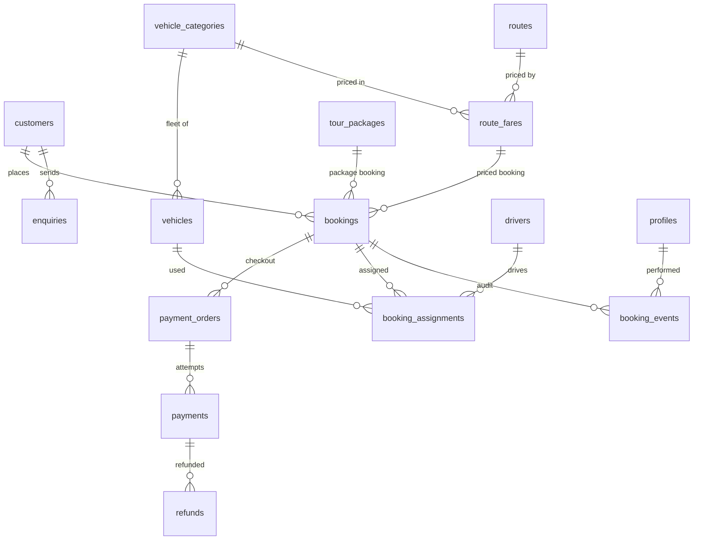
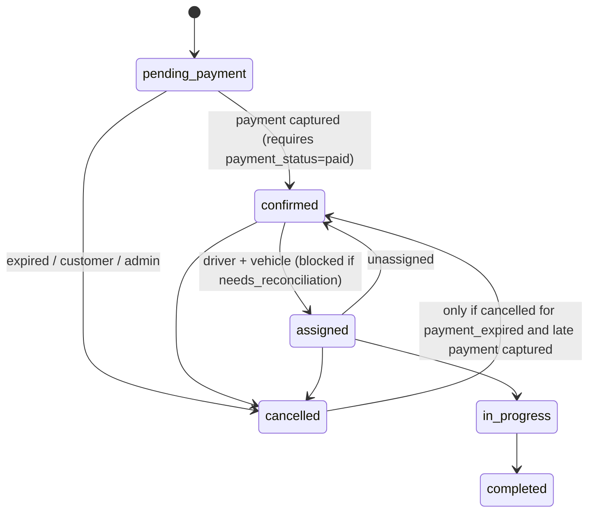

# Database

All migrations live in `supabase/migrations/` and are applied in filename order.

| Migration | Contents |
| --- | --- |
| `…0100_foundation` | `set_updated_at()`, `prevent_delete()`, `private` schema |
| `…0200_profiles` | Admin/staff profiles, `is_staff()`, `is_admin()` |
| `…0300_customers` | Guest customers keyed by E.164 phone |
| `…0400_vehicles` | `vehicle_categories` (bookable) and `vehicles` (fleet) |
| `…0500_drivers` | Drivers |
| `…0600_routes_and_fares` | `routes` and `route_fares` (approved price per route × category) |
| `…0700_tour_packages` | Packages (`price_paise` null = enquiry only) |
| `…0800_bookings` | `bookings`, `enquiries` |
| `…0900_payments` | `payment_orders`, `payments`, `refunds`, `webhook_events` |
| `…1000_booking_assignments` | Driver + vehicle assignment history |
| `…1100_booking_events` | Append-only audit log |
| `…1200_state_machines` | Transition table, guards, immutability, automatic audit |
| `…1300_settings_and_rate_limits` | `business_settings` (single row), `consume_rate_limit()` |
| `…1400_rls_policies` | Row Level Security and grants |
| `20261015000100_booking_functions` | Contact snapshot columns; `create_booking`, `create_enquiry`, `lookup_booking_status`, `upsert_customer` (server-only) |

## Entity relationships

## Server-only functions (Phase 2)

| Function | Purpose |
| --- | --- |
| `create_booking(...)` | One transaction: re-checks the fare is active and matches route/category/trip type, seats ≥ passengers, terms version is current; upserts the customer; inserts the booking with a payment deadline. |
| `create_enquiry(...)` | Upserts the customer and stores the enquiry. |
| `lookup_booking_status(reference, phone)` | Returns limited trip fields only when BOTH match. |
| `upsert_customer(...)` | Keyed by phone. Never overwrites an existing name; only fills a missing email. Each booking/enquiry stores the contact details exactly as entered (`contact_name`, `contact_email`). |

All four are revoked from `anon`/`authenticated` and granted only to `service_role`.

## Changes from the original brief (and why)

| Brief | Implemented | Reason |
| --- | --- | --- |
| `vehicles` | `vehicle_categories` + `vehicles` | Customers book a category; admins assign an actual vehicle |
| Fares on `routes` | `route_fares` per route × category | A Sedan and an SUV cost different amounts on the same route |
| `payments` with `gateway_order_id` | `payment_orders` + `payments` | Razorpay allows several attempts per order; keeps "failed never becomes captured" true |
| `booking_status`/`payment_status` | Same, plus `needs_reconciliation` | Safe handling of payments that arrive after cancellation |
| — | `refunds`, `webhook_events`, `enquiries`, `business_settings`, `private.rate_limits` | Refund tracking, idempotency, unpriced routes, admin settings, rate limiting |
| `pickup_datetime` | `pickup_at` (timestamptz) | All times stored in UTC; displayed in IST |

## State machines

Enforced by triggers (`is_valid_transition`), mirrored in `src/lib/booking/states.ts`.

| Machine | Transitions |
| --- | --- |
| `bookings.payment_status` | unpaid→paid; paid→refund_pending/partially_refunded/refunded; refund_pending→paid (refund failed)/partially_refunded/refunded; partially_refunded→refund_pending/refunded |
| `payments.status` | authorized→captured/failed/refunded; captured→refund_pending/partially_refunded/refunded; refund_pending→captured/partially_refunded/refunded; partially_refunded→refund_pending/refunded. **failed and refunded are terminal.** |
| `payment_orders.status` | created→paid/expired; expired→paid (late payment → flag booking) |
| `refunds.status` | pending→processed/failed |

Cancellation and refund are separate operations: cancelling changes `booking_status`; refunding changes payment states.

## Integrity rules (apply to every role, including service_role)

- New bookings must start `pending_payment` / `unpaid`.
- `booking_reference`, `customer_id`, `fare_snapshot`, `total_amount_paise`, `currency`, `terms_*` are immutable.
- Payment amounts and gateway ids are immutable; `amount_refunded_paise` can only grow and never exceed the amount.
- `payment_orders`, `payments`, `refunds`, `business_settings` rows cannot be deleted; `booking_events` cannot be updated or deleted.
- At most one open payment order and one active assignment per booking.

## Row Level Security summary

| Table | anon | staff | admin |
| --- | --- | --- | --- |
| vehicle_categories, routes, route_fares, tour_packages | read active/published | read all | read + write |
| business_settings | read public columns | read | read + update |
| customers, bookings, enquiries | — | read + update | read + update |
| payment_orders, payments, refunds | — | read | read |
| webhook_events | — | — | read |
| vehicles, drivers | — | read | read + write |
| booking_assignments | — | read, insert (as self), update | same |
| booking_events | — | read, insert (as self, actor `admin`) | same |
| profiles | — | read own | read all |

No client role can `TRUNCATE`. No role has delete policies. Writes that create bookings or record payments are done by the server with the secret key.

## Testing

`npm test` runs `tests/db/*.test.ts`, which applies every migration to PGlite with a stub of Supabase's roles and `auth.uid()`, then checks RLS, transitions, immutability and SQL ↔ TypeScript parity. This is a close approximation; before launch, also run `supabase db push` against the staging project and re-run the RLS checks there (Phase 6).

## Adding a migration

1. `npx supabase migration new <name>` (creates a timestamped file).
2. New tables: enable RLS, add policies, `revoke … from anon` for writes, and `revoke truncate … from authenticated` (Supabase grants these by default).
3. Update `src/types/database.ts` (or regenerate) and add tests in `tests/db/`.

## Data retention (to be confirmed with the owner)

- Bookings and payments: keep for the period your accountant confirms is required for GST and income-tax records (typically 6–8 years depending on the business structure); after that, anonymise customer contact details rather than deleting rows.
- `webhook_events.payload`: purge after 180 days (payloads contain customer contact details).
- `private.rate_limits`: self-cleaning (windows older than 1 day).
